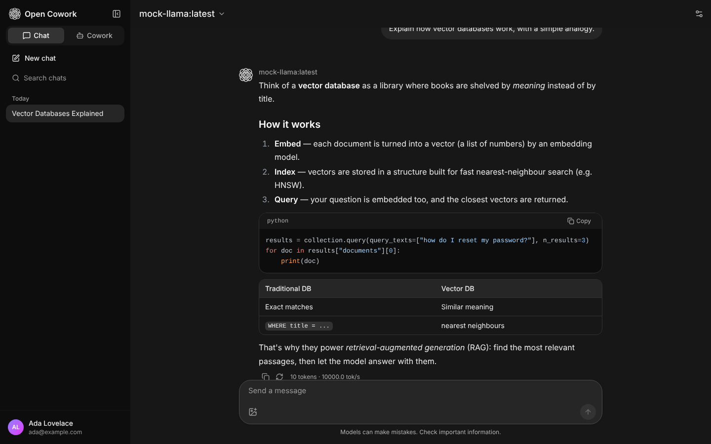
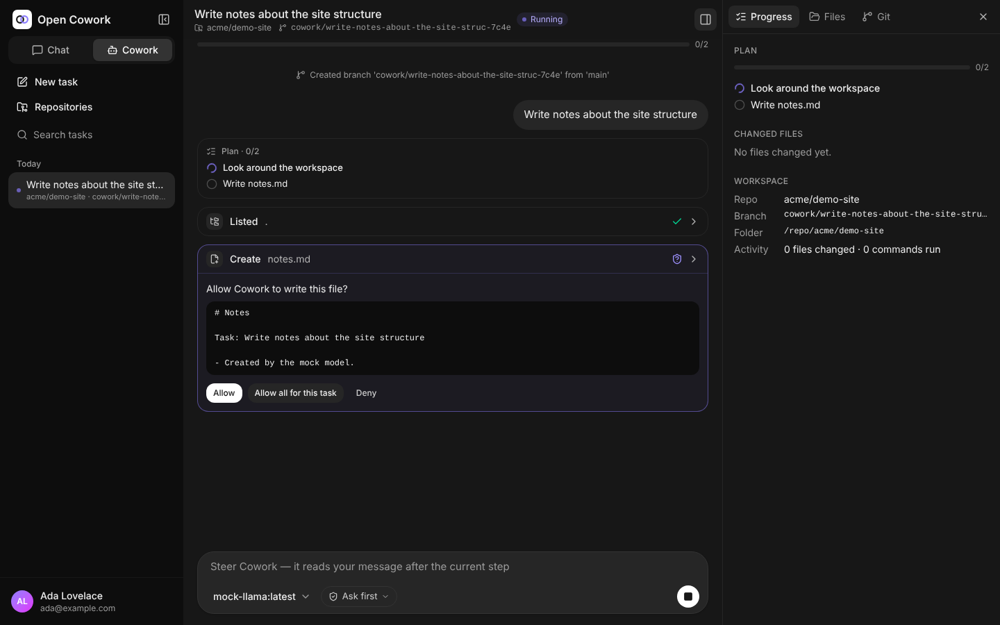
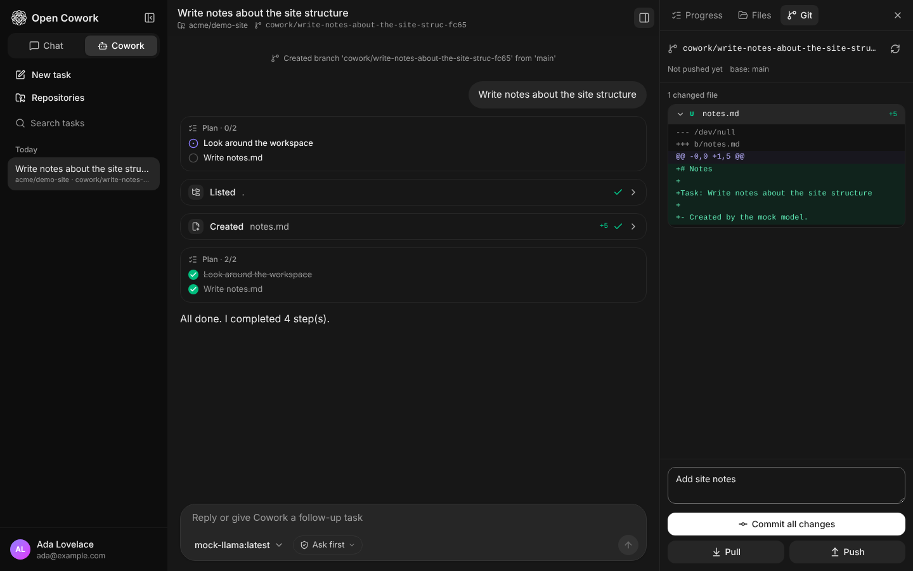

<p align="center"></p>

# Open Cowork

A self-hosted, Open WebUI–style workspace for **local models (Ollama)** and **any OpenAI-compatible API**, with a dedicated
**Cowork** tab: an agent that plans a task, then reads and edits files, runs commands and works directly inside your
GitHub repositories while you watch every step.



| Cowork: approve each step | Git panel: diff, commit, push, PR |
| --- | --- |
|  |  |

## Features

**Chat**
- Ollama (native API) and OpenAI-compatible endpoints (OpenAI, LM Studio, vLLM, llama.cpp, LiteLLM, OpenRouter, Groq…), any number of connections at once
- Streaming Markdown with syntax highlighting, tables and reasoning/`<think>` display
- Edit, regenerate, stop; image attachments for vision models; automatic chat titles
- Per-chat controls: system prompt, temperature, max tokens, Ollama context length
- **Web search** (opt-in): a toggle in the chat box searches the web first and answers with numbered, clickable sources
- Chats are saved on the server, so a reply keeps generating even if you close the tab

**Cowork tab**
- Give it a task. The agent writes a plan, then uses tools: `list_files`, `read_file`, `write_file`, `edit_file`, `search_files`, `run_command`, `update_plan`
- **Ask first** mode pauses before every file edit and command (allow once, allow all, or deny). **Auto** mode runs without stopping.
- Live view of each step: streamed command output, diffs for edits, plan progress
- Send a message while it runs to steer it; stop at any time; reload the page mid-run and it picks up where it was
- With web search enabled, the agent can also search the web and read pages (`web_search`, `fetch_url`) while it works
- Side panel with plan, changed files, a file browser (preview, upload, download) and a Git tab
- Each task works in its own folder: a fresh scratch folder in `workspaces/`, or a cloned repository in `repo/`

**GitHub integration**
- Connect with a personal access token, search your repositories and clone them into an easy-to-find **`repo/`** folder (`/repo/<owner>/<name>` in Docker)
- Before a repo task starts, the latest base branch is **pulled** and a fresh **`cowork/<task>-<id>` branch** is created, so the agent never works on `main`
- Git panel: per-file diffs, commit, pull, push and **open a pull request** without leaving the task

**Users & admin**
- **The first account becomes the admin.** Later sign-ups get the default role (`pending` by default, so an admin has to activate them)
- Sign-ups can be turned off; admins can still add accounts
- Admin panel: users and roles, model connections (with presets and connection tests), sign-up policy, Cowork limits (shell access, timeouts, steps, context length), feature toggles

## Quick start

### Docker (recommended)

With [Ollama](https://ollama.com) running on your machine:

```bash
git clone https://github.com/cametendo/open-cowork.git
cd open-cowork
docker compose up -d
```

Open http://localhost:3001 and create the first account, which becomes the admin. Cloned repositories appear in
`./repo` and Cowork scratch folders in `./workspaces`, next to the compose file.

The container uses the machine's own network, so Ollama on `localhost:11434` works with its default settings, VPNs and
Tailscale (exit nodes, MagicDNS) behave like they do for the machine, and Open WebUI can keep port 3000. To use a
different port, set `OPEN_COWORK_PORT` in `.env`.

**Docker Desktop (macOS/Windows):** host networking is off there by default, so add the bridge file, which publishes
port 3001 and reaches Ollama through `host.docker.internal`:

```bash
docker compose -f docker-compose.yml -f docker-compose.bridge.yml up -d
```

To make that the default, put `COMPOSE_FILE=docker-compose.yml:docker-compose.bridge.yml` in `.env` (use `;` instead
of `:` on Windows).

**If the build can't reach the internet** (for example behind a VPN or a Tailscale exit node), build on the machine's
network yourself, then start as usual:

```bash
docker build --network host -t open-cowork:latest .
```

```bash
docker compose up -d
```

To run Ollama in a container as well (Linux; skip this if Ollama is already installed on the machine):

```bash
docker compose -f docker-compose.yml -f docker-compose.ollama.yml up -d
```

```bash
docker compose exec ollama ollama pull qwen3:8b
```

To use an OpenAI-compatible API, copy `.env.example` to `.env` and set `OPENAI_API_BASE_URL` and `OPENAI_API_KEY`
before the first start, or add a connection later in **Admin › Connections**.

### Portainer

Use [`docker-compose.portainer.yml`](docker-compose.portainer.yml). It pulls the published image instead of building
from source, so it works in Portainer's web editor.

1. **Stacks › Add stack**, name it `open-cowork`, and paste the file into the web editor (or choose **Repository** and
   set the compose path to `docker-compose.portainer.yml`).
2. Optionally set environment variables: `OPEN_COWORK_PORT` (default `3001`), `OLLAMA_BASE_URL`, and
   `OPEN_COWORK_HOST_DIR` (default `/opt/open-cowork`; repositories go to `<dir>/repo`, task folders to `<dir>/workspaces`).
3. Deploy and open `http://<your-server>:3001`.

To update, open the stack, click **Update the stack** and choose to re-pull the image. Your data is kept; see
[Data, updates and backups](#data-updates-and-backups). The image is published when a release is tagged
(see [Releasing](#releasing)).

### Local (no Docker)

Requirements: Python 3.11+, Node.js 20+ (only to build the UI) and git.

```bash
./start.sh
```

This creates a virtualenv in `backend/.venv`, installs dependencies, builds the UI and serves everything on
http://localhost:3001. Repositories go to `./repo` and task folders to `./workspaces`.

To work on the code, start the API with auto-reload plus the Vite dev server on http://localhost:5173:

```bash
./start.sh --dev
```

<details>
<summary>Manual steps (Windows or custom setups)</summary>

```bash
cd frontend
npm ci
npm run build
cd ../backend
python -m venv .venv
.venv/bin/pip install -r requirements.txt
.venv/bin/python -m open_cowork --port 8080
```

On Windows, use `.venv\Scripts\pip` and `.venv\Scripts\python`.
</details>

## Web search

Off by default, because search queries (and the pages Cowork reads) leave your server. Turn it on in **Admin › Web
search**, pick an engine and press **Test search**:

| Engine | Needs | Notes |
| --- | --- | --- |
| DuckDuckGo | nothing | Works without an account, but DuckDuckGo may rate-limit automated searches |
| SearXNG | your own server | Self-hosted and private. Enable the JSON format in its `settings.yml` (`search: formats: [html, json]`) |
| Brave Search | API key | [brave.com/search/api](https://brave.com/search/api/), has a free tier |
| Tavily | API key | [tavily.com](https://tavily.com), has a free tier |

API keys are stored encrypted and never sent back to the browser.

- **Chat:** a **Web search** toggle appears next to the message box. The question is searched, the top results are added
  to the prompt, and the answer cites them as `[1]`, `[2]` with links and source chips. It works with any model, no
  tool calling needed.
- **Cowork:** the agent gets `web_search` and `fetch_url`. They only read, so they never ask for approval.
- **Private addresses are blocked.** `fetch_url` only opens public internet pages, so the agent can't be pointed at
  `localhost`, your LAN, Tailscale machines or cloud metadata addresses. The check runs on the address actually
  connected to, for every redirect. Admins can turn it off with **Allow fetching private addresses** if Cowork should
  read internal pages. (The search engine itself can be on `localhost`, e.g. a SearXNG container.)
- Web pages are untrusted input. Models are told not to follow instructions found in them, but a page can still try to
  steer the agent, which is one more reason to keep **Ask first** mode on for tasks that read the web.
- Fetching goes straight out; it doesn't use `HTTP_PROXY`/`HTTPS_PROXY`. Behind a corporate proxy, either use an
  engine with an API (those requests do honor the proxy) or allow private addresses so the proxy-aware client is used.

## Choosing models for Cowork

Cowork relies on **tool calling**. Good local choices include `qwen3`, `qwen2.5-coder`, `llama3.1`/`llama3.3`,
`mistral-nemo`, `gpt-oss` and `devstral`. Models without tool support return an error explaining this.

Agents need context room for file contents and command output. For Ollama, Cowork runs request `num_ctx = 16384` by
default (change it in **Admin › Cowork & GitHub**; `0` uses the model's default).

## GitHub setup

1. Open **Settings › GitHub** (or **Cowork › Repositories**).
2. Create a token: a [classic token with the `repo` scope](https://github.com/settings/tokens/new?scopes=repo&description=Open%20Cowork),
   or a fine-grained token with **Contents** and **Pull requests** set to read & write.
3. Paste it and click **Connect**. The token is stored encrypted and is only used for your own requests.
4. Clone a repository from the list, or type `owner/repo`. Public repositories can be cloned without a token.
5. Start a task from the repository. When it's done, review the diff in the **Git** tab, commit, push and open a pull request.

Admins also see any git repository placed by hand in the repo folder (one or two levels deep, e.g.
`repo/my-project` or `repo/acme/my-project`).

## Configuration

Environment variables (see `.env.example`). Values marked *first boot* only seed the database; after that they are
managed in the admin panel.

| Variable | Default | Description |
| --- | --- | --- |
| `OPEN_COWORK_PORT` | `3001` | Port for Docker Compose, Portainer and `./start.sh` |
| `PORT` / `HOST` | `3001` / `0.0.0.0` | Where the server listens (inside the image it defaults to `8080`, which `docker-compose.bridge.yml` maps to `OPEN_COWORK_PORT`) |
| `DATA_DIR` | `backend/data` (`/app/backend/data` in Docker) | SQLite database and generated secret key |
| `REPO_DIR` | `./repo` (`/repo` in Docker) | Where repositories are cloned |
| `WORKSPACE_DIR` | `./workspaces` (`/workspaces` in Docker) | Scratch folders for Cowork tasks |
| `WEBUI_SECRET_KEY` | generated | Signs sessions and encrypts stored tokens and API keys. Keep it stable. |
| `WEBUI_NAME` | `Open Cowork` | Instance name (*first boot*) |
| `ENABLE_SIGNUP` | `true` | Allow new sign-ups (*first boot*) |
| `DEFAULT_USER_ROLE` | `pending` | `pending` or `user` (*first boot*) |
| `OLLAMA_BASE_URL` | `http://localhost:11434` | Initial Ollama connection (*first boot*); `http://host.docker.internal:11434` with the bridge file |
| `ENABLE_OLLAMA_API` | `true` | Enable that connection (*first boot*) |
| `OPENAI_API_BASE_URL` / `OPENAI_API_KEY` | — | Initial OpenAI-compatible connection (*first boot*) |
| `COWORK_ALLOW_SHELL` | `true` | Let the agent run shell commands (*first boot*) |
| `JWT_EXPIRES_HOURS` | `168` | Session lifetime |
| `GITHUB_API_URL` / `GITHUB_URL` | github.com | For GitHub Enterprise Server |
| `CORS_ALLOW_ORIGINS` | — | `;`-separated origins, only needed if the UI is served elsewhere |
| `DATABASE_URL` | SQLite in `DATA_DIR` | SQLAlchemy URL |

## Data, updates and backups

| What | Docker / Portainer | Local (`./start.sh`) |
| --- | --- | --- |
| Accounts, chats, Cowork tasks, connections, settings, encrypted GitHub tokens, secret key | `open-cowork-data` volume (`/app/backend/data`) | `backend/data/` |
| Cloned repositories | `./repo` (Portainer: `/opt/open-cowork/repo`) | `./repo` |
| Cowork scratch folders | `./workspaces` (Portainer: `/opt/open-cowork/workspaces`) | `./workspaces` |

All of this survives restarts, reboots and updates: the container restarts by itself after a reboot, and replacing it
with a new image keeps the volume. Data is only lost if the volume itself is deleted (`docker compose down -v`,
`docker volume rm`), or if the image runs without a volume for `/app/backend/data`. A Cowork task that is running when
the server stops is interrupted; the steps it finished are kept and you can send a message to continue.

**Updating**

- Docker Compose (built from source): `git pull`, then `docker compose up -d --build` (or the `docker build --network host`
  command above if the build can't reach the internet, followed by `docker compose up -d`)
- Portainer or the published image: update the stack and re-pull the image
- Local: `git pull`, then `./start.sh --rebuild`

On startup the database is upgraded to the new version automatically. Before an existing database is upgraded, a copy
is saved next to it as `open-cowork.backup-<revision>-<date>.db` (the five newest are kept).

Keep `WEBUI_SECRET_KEY` the same across updates, or leave it empty so the generated key in the data folder is used.
Changing it logs everyone out and makes stored GitHub tokens and API keys unreadable; accounts and passwords are not
affected.

**Backup and restore**

The container is called `open-cowork` in both compose files. Stop it so the database is consistent, then archive the
data folder into the current directory:

```bash
docker stop open-cowork
docker run --rm --volumes-from open-cowork -v "$PWD":/backup alpine:3 tar czf /backup/open-cowork-backup.tgz -C /app/backend/data .
docker start open-cowork
```

To restore, replace the data folder with the backup:

```bash
docker stop open-cowork
docker run --rm --volumes-from open-cowork -v "$PWD":/backup alpine:3 sh -c 'rm -rf /app/backend/data/* /app/backend/data/.[!.]* && tar xzf /backup/open-cowork-backup.tgz -C /app/backend/data'
docker start open-cowork
```

Running locally, stop the server and copy `backend/data/`.

## Security notes

Cowork is a real agent: with shell access on, it can run any command the server process can. Treat it like giving
someone a terminal.

- In Docker it is confined to the container and the folders you mount (`repo/`, `workspaces/`). Running locally, it
  has your user's permissions.
- With the default host networking, the agent's commands can also reach services that listen only on the machine's
  `localhost`. Use `docker-compose.bridge.yml` if you want the container on Docker's separate network instead.
- Admins can turn off shell commands, which limits the agent to reading and editing files inside the task's workspace.
- File tools are confined to the task's workspace (symlinks included). Commands run with a scrubbed environment, so
  the server's secrets and API keys aren't visible to them.
- **Ask first** mode (the default) requires approval for every edit and command.
- The GitHub token is never written to `.git/config` or given to the agent. Pushing and opening pull requests happen
  from the Git panel. Repository hooks are disabled for git commands the server runs, and the token is only sent to
  the clone's own GitHub remote.
- Only trusted users should get Cowork access in multi-user setups. You can disable Cowork for non-admins.

## Development

```
backend/              FastAPI app (python -m open_cowork)
  open_cowork/
    routers/          auth, users, admin, connections, chats, cowork, github
    websearch/        search engines and the safe page fetcher
    providers/        Ollama + OpenAI-compatible streaming clients
    cowork/           agent loop, tools, prompts, workspaces
    github/           GitHub API client and git helpers
    migrations/       Alembic database migrations (applied on startup)
  tests/              pytest suite + mock_llm.py (fake Ollama/OpenAI server) + mock_web.py (fake search + pages)
frontend/             React + Vite + Tailwind UI
```

Run the tests:

```bash
cd backend
.venv/bin/pip install -r requirements-dev.txt
.venv/bin/python -m pytest
```

To build the UI without a GPU, run the bundled fake model server and add it as a connection (Ollama type
`http://localhost:11555`, or OpenAI type `http://localhost:11555/v1`):

```bash
backend/.venv/bin/python backend/tests/mock_llm.py --port 11555
```

### Database changes

After changing `models.py`, generate a migration and review the new file in `open_cowork/migrations/versions/`. It
compares against your local database in `backend/data`, so start the app once first.

```bash
cd backend
.venv/bin/alembic revision --autogenerate --rev-id 0002 -m "add user timezone"
```

The test suite fails if a model change has no matching migration.

### Releasing

Pushing a version tag builds the Docker image for linux/amd64 and linux/arm64 and publishes it to GitHub Container
Registry as `ghcr.io/cametendo/open-cowork:0.2.0`, `:0.2` and `:latest`:

```bash
git tag v0.2.0
git push origin v0.2.0
```

After the first release, check the package's visibility on GitHub (your profile › Packages › open-cowork). If it's
private, either make it public or add `ghcr.io` as a registry in Portainer with a token that can read packages.

## License

MIT
